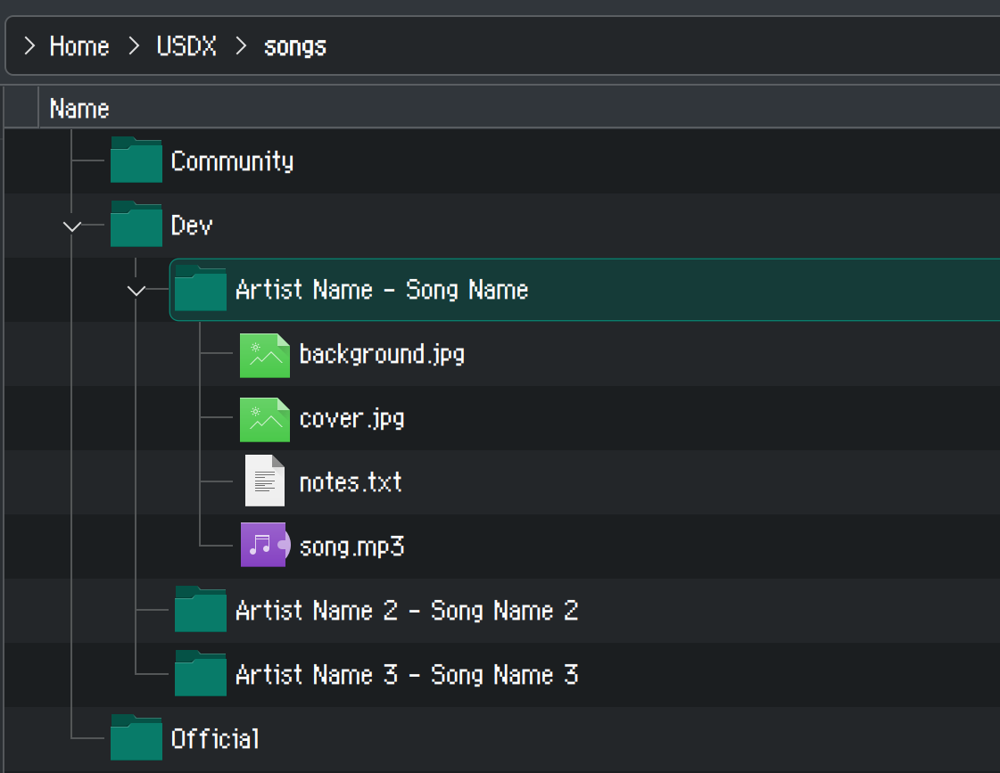

# Running My Little Karaoke in 2026

## Introduction

If you've been to a My Little Pony convention any time in the past fifteen years (oof) or so, or if you just like the idea of singing along to pony songs in general, chances are you've heard of My Little Karaoke: Singing is Magic. In essence, it's a song pack and theme for the SingStar simulator UltraStar Deluxe that was first released in 2012. Since then, over eight hundred songs have been charted for the 'game', making it one of the largest single-download collections of (mostly) consistently high-quality charting in the UltraStar ecosystem, and possibly among the largest for rhythm games in general.

That being said, a lot of progress has been made in the last couple of years. To date, there are over five hundred new songs that are unreleased, and many others reworked to improve chart quality. UltraStar Deluxe, the software that powers My Little Karaoke, has also seen countless quality-of-life updates, with many more to come in the future. However, those unfamiliar with the program and ecosystem may be unable to take advantage of these improvements.

This guide, geared towards home users, convention hosts, and anyone in between, aims to get people up to speed on these improvements, so that people can have a much improved karaoke experience. One can only hope that we will have many years of karaoke to come, and that there will always be people around to chart the latest songs of the pony fandom, even fifteen years on. :)

## Overview

This guide will be divided into a few main sections:

- The first section will be about getting the base content of My Little Karaoke itself (the 'base game'). Because of changes in operating systems over the years, particularly on macOS and Linux, the experience is a bit less 'plug-and-play' on non-Windows operating systems, so the main goal of this section will just be to get the songs, rather than necessarily to get the game running.
- The second section will be about updating the UltraStar Deluxe software itself, which is generally needed for compatibility with newer audio standards (e.g. OPUS, better compatibility on non-Windows operating systems, quality-of-life features).
- The third section will be about downloading 'new releases' from the online portal, which contain a hundred or so songs that are not directly included with the program.
- The fourth section will be about acquiring the five hundred or so unreleased songs, which haven't been checked for artist permission or quality assurance, but are still generally playable. (This is what you sometimes see at conventions -- or at least, the cool ones!).
- The final section acts as a sort of 'appendix' for things that are not necessarily covered by the main sections, such as:
    - Using an Android device as a karaoke machine, and alternatives to UltraStar Deluxe
    - Adding your own songs to the game, outside of the ones listed on this tutorial
    - Creating charts for songs that aren't in the game yet
    - Requesting charts for songs that aren't in the game yet

## What You Need

My Little Karaoke primarily runs on computers running a desktop operating system. There are not really any published minimum requirements, but generally speaking:

- The game can *run* on low-power devices, even as weak as a Raspberry Pi
    - Due to the game frequently using video, you should ensure that your device has the hardware capability to decode video without severe performance issues. In the event that video is causing performance issues, you can [disable it from within config.ini](https://github.com/UltraStar-Deluxe/USDX/issues/12).
- The game can run on most modern consumer operating systems (Windows, macOS, Linux) on x86 or ARM-based processors
- The base game currently requires roughly 25GB of space, new releases around 3GB of space, and unreleased songs around 25GB of space, totalling around **53GB** of total space. This can be reduced after-the-fact by removing video (*.mp4) files, obviously at the expense of playing video.
- You can use any USB microphone (e.g. SingStar PS2 microphones, Rock Band microphones). If you have a lot of money, you can also invest in proper wireless microphones connected to a mixer and have the game take them that way. If you're playing solo at home, even something like a laptop microphone will probably work, although you may end up also picking up audio from the game itself.

## If You Need Help

If you need help with any of the instructions here, feel free to ask me on Discord (@horse.horsehorsehorsehorse.horse or @lilyshy). I can generally be found on the [My Little Karaoke Discord server](https://discord.gg/UsGcpnv).

## Section 1: Getting My Little Karaoke's base songs

Installing My Little Karaoke is generally pretty trivial on Windows, and a bit more difficult on macOS/Linux. For this reason, if you're just starting out, it'll probably be easiest to deal with things if you set it up on **Windows** (the songs themselves are portable and can be used on any operating system once you have them). Step-by-step instructions still exist for macOS/Linux, but are a bit more technical and involve running a script via the command line.

!!! warning "File size notes"

    *My Little Karaoke*'s base game as a whole currently takes consumes around 25 gigabytes of space. There is unfortunately no way to reduce this during the download process, although you *can* delete videos after the fact (at the expense of seeing videos in-game, obviously), which will reduce it to around 10 gigabytes.

### Windows

Installing My Little Karaoke currently works the best on Windows. From the [game download](https://www.mylittlekaraoke.com/index.php?pages/Game-download) page, click on "Windows" and you'll download a file called "MyLittleKaraoke_WebInstall.exe". Just run the program, select where to install it, and it will handle the rest.

Navigate to the location that the game is installed: in my case, that's M:/MyLittleKaraoke. Please remember this directory, as you will need it later.

Once the game is installed, you'll be able to launch it by opening the "My Little Karaoke - Singing is Magic" application, then clicking on "Play My Little Karaoke". The game will actually work outright at this point, but I would recommend continuing to the next section of this guide to update the program.

### macOS

On macOS, there is theoretically a My Little Karaoke installer similar to the one on Windows, but it has a few problems:

- Portions of it do not work, due to macOS [discontinuing support for 32-bit apps](https://support.apple.com/en-ca/103076) in 2019
- The installer installs a really old version of the program and dumps the songs in there, which makes it a lot less portable
- The old version of the program is very buggy on modern macOS
- The installer will likely outright break in 2027 with the [discontinuation of support for Intel-based apps](https://9to5mac.com/2026/02/16/macos-26-4-will-notify-users-of-rosetta-2-discontinuation/)

As a temporary solution, I've modified the shell script that is the basis for the macOS installer so that it is more similar to the Linux shell script. However, this will involve using the command line.

!!! warning "Here be dragons"

    I've tested this script on my own device, but there's always the possibility of something going wrong or something I did not account for.

!!! warning "Directory must not have spaces"

    The script will probably not work as expected if the directory it is in has any spaces in it.

First of all, download the song download script from [here](/resources/mlk/download-mlk-songs-macos.sh). By default, it will probably end up in your `Downloads` folder.

Then, open a Terminal window:

By default, when you open Terminal, you will be in your home directory (~), so you will need to run `cd` to get to wherever the script is. So, assuming it's still in your downloads folder, type `cd Downloads`, then hit Return and you should see the output change to `user@hostname Downloads %`:

In this case, you can see I've also run `ls` to make sure that `download-mlk-songs-macos.sh` is in the directory I'm in.

Once you are in the same directory as `download-mlk-songs-macos.sh`, you will need to give permission to execute it. You can do this by typing `chmod +x download-mlk-songs-macos.sh`, then hitting Return:

Then simply type `./download-mlk-songs-macos.sh`, and then script should begin to execute:

When the script is done, you should see the message `My Little Karaoke, Singing is Magic 4 is now installed`. When you check your `Downloads` folder, you should see two folders: `songs` and `theme`.

The `songs` folder contains the base songs of My Little Karaoke, and you'll want to keep it for the next steps. The `theme` folder can be deleted.

### Linux

My Little Karaoke can normally be installed via Lutris. However, at time of writing, the Lutris installer is not working properly, and is somewhat outdated anyway. So, like macOS, I will be providing instructions for using the command line (which I assume you will be a bit more familiar with as a Linux user).

If you would still like to try using Lutris, I would recommend getting the "UltraStar Deluxe Addon version", since you will probably need to update UltraStar Deluxe anyway and the modern ways of running it (AppImage, Flatpak) are a lot more intuitive than the precompiled Lutris build.

!!! warning "Directory must not have spaces"

    The script will probably not work as expected if the directory it is in has any spaces in it.

To install the song pack via the command line, you will just need the song download script. You can get that [here](/resources/mlk/download-mlk-songs.sh). You may need to run `chmod +x` it to get it to execute:

If it is working properly, then you should see some download progress bars, along with three folders being created in the same directory as `download-mlk-songs.sh`: `temp`, `songs`, and `themes`, as well as a file called `mlk.cache`. Let the script download everything; when it's done, you should see "You can now close this window" in the terminal window:

You should ultimately end up with two folders in your working directory (where `download-mlk-songs.sh` is): `songs` and `themes`.

The `songs` folder contains the base songs of My Little Karaoke, and you'll want to keep it for the next steps. The `themes` folder can be deleted.

For now, you may want to keep the `mlk.cache` file somewhere along with the `download-mlk-songs.sh`, as in the event that the base songs are updated, this will prevent you from needlessly redownloading things.

### Next steps

By the end of this section, you should have My Little Karaoke's base songs, around 25GB in size. The `songs` folder should contain two folders: `Official` (containing official show songs) and `Community` (containing fandom songs). On Windows, you will also have a launchable program and the ability to install `.mlk` song files, but we will ignore these in favour of properly updating the game.

Next, we will install/update UltraStar Deluxe, the software used to run My Little Karaoke's songs/charts.

## Section 2: Installing/Updating UltraStar Deluxe

*My Little Karaoke* is based on UltraStar Deluxe, a simulator for Sony's SingStar series of karaoke games. The version of UltraStar Deluxe that is shipped with My Little Karaoke depends on your operating system, ranging from a 2017 version on macOS to a 2020 build on Windows and Linux.

While the old version of the program is technically *functional* (particularly on Windows), it is missing many of the improvements/features added to UltraStar Deluxe over the past few years, including:

- Support for some less frequently used audio formats, like OPUS
- Improved skipping for instrumental breaks with the `S` hotkey
- Support for more consistent audio volume via ReplayGain
- Removal of the broken automatic voice filtering instrumental thingy that people would sometimes automatically enable and then not know how to turn off (`K` hotkey in song selection)
- Support for the newly standardized UltraStar song format, with features such as tags (for improving song search)
- Significantly faster song loading with a progress bar
- An automatic count-in time when the first note is very early in the song
- More verbose volume control
- More precise scoring that uses the ones digit instead of rounding to the nearest 10
- More highscore entries can be displayed at once
- Saving scores for duet charts

Audio format support is particularly important, as some charts may reference audio that will **possibly crash the game** if it is not supported by the old version.

### Getting an updated UltraStar Deluxe

You can get the latest release of UltraStar Deluxe from the [GitHub repository](https://github.com/UltraStar-Deluxe/USDX/releases/latest).

On all operating systems, you can compile from source by following the instructions [here](https://github.com/UltraStar-Deluxe/USDX/blob/master/COMPILING.md), but there is no real advantage to doing so for normal gameplay purposes. Commits and pull requests are automatically built by GitHub and can be downloaded ('artifacts') if you have a GitHub account, if you would like to test a new feature in advance without compiling it yourself.

#### Windows

Windows users can select `windows-installer` or `windows-portable`; the `installer` will have you select where to install things, while the `portable` will just be a bunch of files in an archive that you will have to extract to your desired location.

In theory, you can actually just drag and drop everything from the `portable` ZIP to your My Little Karaoke install directory, and then just replace any conflicting files. This will probably result in some unnecessary files being kept, so I would instead recommend installing it somewhere else.

#### macOS

macOS users should select `mac-ARM` if they have an Apple Silicon-based Mac (any Mac released in 2020 and later, with an M1/M2/M3/M4/M5/A18 chip), and `mac-x86` if they have an Intel-based Mac (anything older). If you're not sure what you have, click on the Apple logo on the top left, then "About This Mac". It will tell you what chip/processor you have.

The program is installed the same way as any other program on macOS: When you open the `.dmg` file, it'll be 'mounted' as a drive, and then you can drag-and-drop UltraStar Deluxe into the Applications folder.

Due to Apple being extremely annoying with unsigned applications, you will need to manually give permission to actually run the program. See [here](https://wiki.hacks.guide/wiki/Open_unsigned_applications_on_macOS_Sequoia_and_newer) for instructions on how to do that. If you know what you're doing: `sudo xattr -d com.apple.quarantine /path/to/app`

#### Linux

As of UltraStar Deluxe v2026.10.0, [loading custom assets is properly supported on AppImage and Flatpak](https://github.com/UltraStar-Deluxe/USDX/pull/1422). Hooray!

On Linux, your options for running the game are:

- AppImage: available on the repository (the file with the `AppImage` extension). You can launch it by just double-clicking on it (you may need to create a desktop entry for it to appear in your application list, depending on your desktop environment.)
- Flatpak: available from [Flathub](https://flathub.org/en/apps/eu.usdx.UltraStarDeluxe), in which case a desktop entry may be automatically generated.
- AUR: [here](https://aur.archlinux.org/packages/ultrastardx-git)

### Moving your songs over

On Windows, the base songs are probably currently located in the MyLittleKaraoke install directory (e.g. `C:/MyLittleKaraoke/songs`.) You can simply move them over to wherever UltraStar Deluxe's song directory is. Alternatively, you can specify the song directory (or multiple song directories, even) with the `SongDir=...` arguments in `config.ini`.

If you were following this guide on macOS or Linux, you will just have a `songs` folder in the working directory where the `download-mlk-songs` shell script was located. Just like on Windows, you can move them to UltraStar Deluxe's song directory, or specify a song directory in `config.ini`. (If you're using Flatpak, note that the application is sandboxed and you will need to allow access to the directory by specifying it via Application Settings or Flatseal in order to specify any directory outside of `~/.var/app/eu.usdx.UltrastarDeluxe/.ultrastardx`.)

- **macOS**: Songs can be stored in `~/Music/UltraStar Deluxe` (that is, your user account's `Music` folder). They can also be stored in `~/Library/Application Support/UltraStar Deluxe/songs`. (This folder is hidden by default; you can unhide hidden folders and files with Command+Shift+Period, or access it through Finder's "Go to Folder" menu option.)
    - On versions prior to 2026.10.0, the user folder is `~/Library/Application Support/UltraStarDeluxevXXXX.XX.X`, and must be migrated between updates.
- **Linux** (AppImage): `~/.ultrastardx/songs`
- **Linux** (flatpak): `~/.var/app/eu.usdx.UltraStarDeluxe/.ultrastardx/songs/`.

At this point, you can launch the game and see if it's working properly. If it is:

- You should see over a thousand songs available on the song select screen
- The current UltraStar Deluxe version should be 2026.10.0 or newer (or whatever the latest may be when you are following this guide)

### Applying the My Little Karaoke theme and avatars

No matter your operating system, you will probably have downloaded some form of the My Little Karaoke theme, but the theme will likely not work as-is due to updates to the theme system in newer version of UltraStar Deluxe.

Fortunately, you can get an updated version of the theme from [here](https://github.com/barbeque-squared/usdx-mylittlekaraoke-theme/archive/refs/heads/master.zip).

You can also get the avatars, provided separately, from [here](https://djazz.se/nas/games/?dl=my-little-karaoke-avatars) and/or [here](https://www.mylittlekaraoke.com/store/webinst/avatars1.mlu) (the `.mlu` file is just a renamed `.tar`). Use 7-Zip or any other unarchiving program to unzip it.

When you download the theme, you will see a `themes` folder, which will contain a `MyLittleKaraoke` folder and `MyLittleKaraoke.ini`. Move the folder and its INI to your `themes` folder. Avatars (the `.png` files from the `.tar` and `.mlu` archives) should go to your `avatars` folder:

- **Windows**; macOS/Linux compiled from source: `<install directory>`, e.g. `C:/Games/UltraStarDeluxe`
- **macOS**: `~/Library/Application Support/UltraStar Deluxe`
- **Linux** (AppImage): `~/.ultrastardx`
- **Linux** (flatpak): `~/.var/app/eu.usdx.UltraStarDeluxe/.ultrastardx`

### Updating UltraStar Deluxe

UltraStar Deluxe is usually updated every month or so. From time to time, you may wish to update it to take advantage of newly added features or bug fixes, which will be posted in the changelog of each version.

How you update the program depends on your operating system:

- On **Windows**, you can download the newest portable release and copy it to another directory. You can also try running the newest installer, which should recognise your existing install and install over it while retaining your data.
- On **macOS**, you can run the `.dmg` file and copy `UltraStar Deluxe` to your `Applications` folder, replacing the existing one. As of v2026.10.0, your data should transfer over automatically, as the same Application Support folder will be used throughout.
- On **Linux**:
    - **AppImage**: You can just download and run the new AppImage. The same `.ultrastardx` directory should be used and retained.
    - **Flatpak**: You can update it just as you would any other flatpak (from your app store or command line or otherwise). Updates may be delayed as they rely on Flathub.
    - **Compiled from source**: If necessary, `git pull` the latest copy of the repository, then recompile with `./autogen.sh && ./configure && make`. Output will be in the `game` folder of your local copy of the repository.

Sometimes, you might want to copy everything to a new install. To do so, move `Ultrastar.db` (the score database), `songs`, `avatars`, and `config.ini` (game configuration) to the new installation directory.

The theme may need to be updated separately. If this is the case, the changelog will normally indicate a 'breaking change' with the theme, which means that the theme may work as expected if it is not updated. To update the theme, delete the old one from from your `themes` folder, download the new one from [the theme repository](https://github.com/barbeque-squared/usdx-mylittlekaraoke-theme/archive/refs/heads/master.zip), and place the theme folder and its INI in the `themes` folder, the same way that you did when first installing the theme.

### Next steps

By the end of this section, you should have the base songs, along with the My Little Karaoke theme/avatars, running on a modern version of UltraStar Deluxe.

Any new songs you get -- whether they be new releases, or unreleased, or even completely unrelated to pony -- should go in your `songs` folder, or to an otherwise specified directory in `config.ini`.

Next, we will download new releases from the My Little Karaoke website.

## Section 3: Downloading New Releases

Since early 2022, new song releases have been distributed from the [online "new releases"](https://www.mylittlekaraoke.com/store/beta/releases.html) page (despite the URL, the songs are not necessarily in 'beta'; they are considered to be at least identical in quality to the songs that are included in the base game). Each song comes as its individual `.tar.mlk` file, which, as the name suggests, is actually a `.tar` file. So, you can just download all of them, then extract them with a conventional file manager (i.e. 7-Zip).
Each `.tar.mlk` contains a `Downloads` folder, which contains the song itself (along with any other songs that are included in the song release, such as for the 4EverfreeBrony song packs). If you download several `.tar.mlk` files, you should be able to extract them all simultaneously (`for f in *.tar.mlk; do tar xf "$f"; done` for example).

The end result should be a `Downloads` folder which contains a bunch of songs. You can move this `Downloads` folder to your `songs` directory, such that you now have three folders in there: `Official` (official show songs), `Community` (fandom songs), and `Downloads` (new releases).

On Windows *only*, assuming you've used the web install executable to install My Little Karaoke, double-clicking on a `.tar.mlk` file will automatically extract it to the My Little Karaoke installation's song directory (as specified during initial install). If you've installed an updated UltraStar Deluxe somewhere else on your computer, then it probably won't end up in the right place.

### Next steps

By the end of this section, you should have downloaded and extracted (or installed) at least *some* new releases from the online new releases page. Of course, if you're running this at an event, you may want to get all of them!

Next, we will talk about acquiring unreleased songs.

## Section 4: Acquiring Unreleased Songs

Despite the implication, 'unreleased' songs are generally not that low quality or unstable: in fact, if you've played at a convention, you've probably played at least some of them! 

The reason some songs are 'unreleased' is that songs are individually and manually released after goign through QA, which generally falls on one person to do. As a result songs, are generally created faster than they can be added to the public game. These songs may also be waiting on permission from the artist who created or sang them, and may be missing things that would otherwise go in a 'complete release', such as a cover, background, video, or golden notes.

That being said, unreleased songs are a bit complicated to manage, mainly because there is no online centralized repository for them. Most of these songs are available in *some form* online, but not all of them, and not necessarily on the open Internet.

I would recommend creating a new folder in your `songs` folder called `Dev` or `Beta` or something similar, to differentiate these unreleased songs from the base songs in `Official`/`Community` and the new releases in `Downloads`.

### Pony Karaoke Unreleased Song Pack

This is a song pack containing the 500 or so songs that I've charted for My Little Karaoke that haven't been publicly released yet, so it *most likely* contains what you're looking for. Please see [here](/projects/pony-karaoke) for more information.

### Unreleased songs on the web forum

Some unreleased songs -- mostly songs charted by someone other than myself -- are posted on the [web forum](https://www.mylittlekaraoke.com/forum/index.php?board=19.0). What you get will depend on who made the chart, but generally you will get an archive of some sort which contains:

- The song audio (`.ogg`, `.mp3`, `.flac`, etc)
- A `.txt` file (this is the chart itself)
- A `cover`, `background`, and/or `video` (the cover displays on the song selection screen, and the background and/or video when you play a song)

Extract these into a folder (ideally `Artist - Song Name`), then place that folder into your unreleased songs subdirectory within your songs folder. For example, if you're provided a file called `Cantersoft - Pony Pony Pony Pony.zip` which contains `song.mp3`, `notes.txt`, `cover.jpg`, and `video.mp4`, then copy those contents to a folder called `Cantersoft - Pony Pony Pony Pony` inside of the `Dev` folder. (The actual folder structure is not particularly important, but makes it a lot easier for you to reference and possibly make changes.)

In some cases, you may only be provided a `.txt` file, in which case you will have to manually get the song audio from somewhere else, then reference it under the `#MP3` header in the text file (which can be any file format). For example, you could specify `#MP3:great-to-be-different.ogg` to have the song look for the file `great-to-be-different.ogg` within the working directory.

### Unreleased songs on the Discord server

The vast majority of releases are also usually cross-posted to the [My Little Karaoke Discord server](https://discord.gg/UsGcpnv); there are also some that have only ever been posted to the Discord server and never on the forum. Generally speaking, just look for any blue links in the `#general` channel and it's probably an unreleased song of some sort.

### If you're looking for a specific song

The easiest way to check if a song has a chart is to check [barbeque's song list](https://barbeque.one/pch/songlist), which is normally linked to at conventions. Songs that are 'unreleased' are marked as 'dev version'. As a rule of thumb:

- Songs charted by myself (lily) are in my song repository
- Songs charted by barbeque (marked 'bbq dev version' or 'dev version') will probably be on the web forum, and cross-posted to the My Little Karaoke Discord server
- Songs charted by BronyMike will only have been posted on the Discord server
- Songs charted by anyone else may be on the web forum, posted to the Discord server, or not publicly available at all

If you need a specific chart, you can ask me directly (@horse.horsehorsehorsehorse.horse or @lilyshy on Discord) and I can find where it is if it's posted publicly, or ask for permission if it's not.

### Next steps

By the end of this section, you should be able to download some unreleased songs and add them to your collection. This should complete your updated pony karaoke setup, which should consist of:

- *My Little Karaoke*'s base songs (Section 1)
- An updated copy of UltraStar Deluxe, the software that powers My Little Karaoke (Section 2)
- *My Little Karaoke*'s new releases (Section 3)
- Some unreleased pony karaoke songs (Section 4)

If you've got all of that, you should be good to go, and should now be armed with the knowledge to add songs going forward! Yay! If not, let me know and we can troubleshoot together.

There are not really any further instructions past this; the appendix just contains some other information that you might find useful.

## Section 5: Appendix

### Full song list

As linked earlier, you can see the current list of pony karaoke songs on [barbeque's song list](https://barbeque.one/pch/songlist). I also maintain my own song list [here](https://docs.google.com/spreadsheets/d/15vsKDhYAiYU4wlFCvjzqbgbqRz_Fzh4PmRUXrcz8VRo/edit?usp=sharing), which may include some pony-adjacent songs that are only listed in the "non-pony" tab on barbeque's list.

On both lists, songs that are vulgar or contain explicit material have been highlighted for your convenience, indicated with Q (Questionable), V (Vulgar), or E (Explicit) on barbeque's list, or highlighted with Sensitive, Explicit, or NSFW on my list. This is a convenience feature and may not be fully comprehensive; if you are running this game at an event where this is unacceptable, it is recommended to screen each song manually beforehand to ensure that they do not contain unacceptable content, or to use ONLY official/show songs (which are guaranteed to be appropriate for all ages).

### Creating your own charts for karaoke

I actually have a separate in-depth tutorial for creating new UltraStar charts (i.e., if a song you want to sing has not been charted yet), if that is a thing you'd like to do. See [here](/guides/karaoke).

### Requesting new songs

If you don't have the time or ability to create your own charts, you can also ask me and I'll see what I can do. See [here](https://docs.google.com/forms/d/e/1FAIpQLSeMS-Pg-IsR2zx-s8dfXNokqvwASJ1P-I_Mah_E5G9dtptp5A/viewform?usp=dialog) for a form you can fill out. Please let me know on Discord (@horse.horsehorsehorse.horse or @lilyshy) if you fill this out, as I don't get notified when this form is filled out and I don't check it very often.

### Using other simulators

UltraStar's format is portable and does not necessarily need to be used with UltraStar Deluxe. [UltraStar Play](https://github.com/UltraStar-Deluxe/Play), for example, is compatible with Android. For more information on the other simulators that exist, see [here](/guides/karaoke/prefaceA/).

